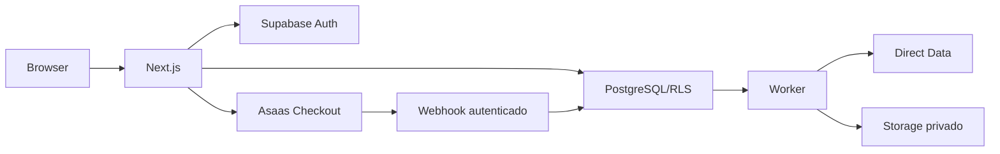

# Arquitetura inicial

Next.js App Router serve páginas públicas, áreas privadas e rotas internas. Supabase cuidará de Auth, PostgreSQL com RLS e Storage privado. Asaas fornecerá checkout hospedado e webhooks. Um worker processará jobs de relatório somente após confirmação de pagamento. A camada Direct Data terá interface de provedor e adaptadores por módulo. Essa integração começa em mock e exigirá licença e credenciais para operação real.

O app público e conteúdo futuro compartilham domínio e design system. Rotas privadas terão `noindex` e autorização no servidor. Na PR-00 só há a página pública e `/api/health`.
